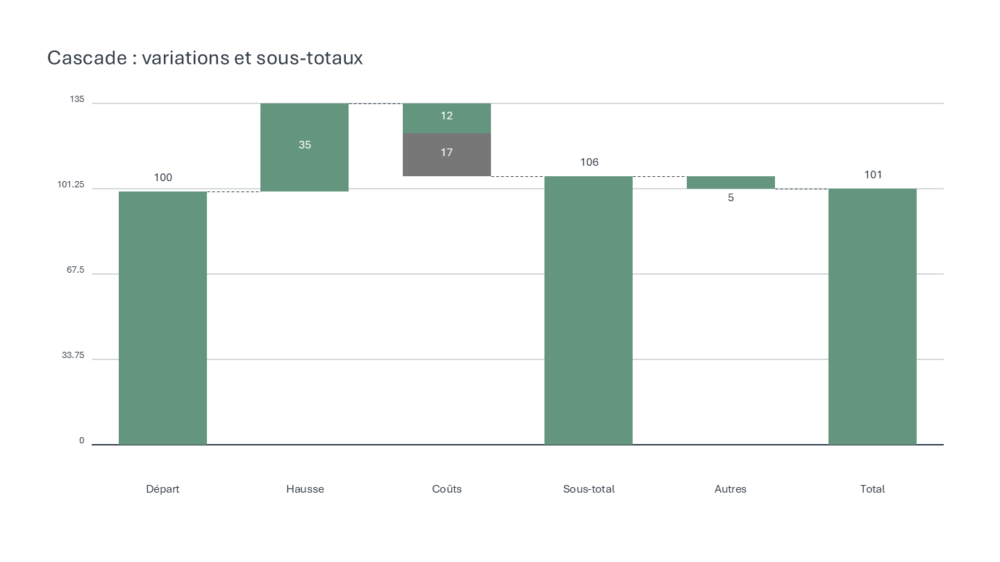

# OpenCharts

Complément PowerPoint Windows open source, sous licence GNU. Le complément s'inscrit actuellement sous le nom **OpenSlideCharts**. Objectif de recherche et de développement : reproduire les fonctionnalités et interactions de think-cell. **La parité n'est pas atteinte. Ce dépôt contient un prototype fonctionnel, pas un remplacement complet.**

## État actuel

- Ruban PowerPoint avec insertion et modification de graphiques.
- Dix types de graphiques : cascade, colonnes, barres, courbe, Mekko à deux segments, Gantt avec calendrier, secteurs, anneaux, dispersion et bulles.
- Gantt : dates, cinq échelles, week-ends ombrés/masqués, plusieurs objets par activité, jalons, crochets, ombres et ancres Excel. Voir [GANTT.md](GANTT.md).
- Dispersion/bulles : groupes, marqueurs, axes numériques linéaires/logarithmiques/inversés, tailles proportionnelles à l'aire ou au diamètre, partitions et régressions linéaires. Voir [SCATTER.md](SCATTER.md).
- Secteurs/anneaux : rotation, quatre ordres, trou transparent, éclatements, couleurs et labels externes depuis un éditeur dédié. Voir [PIE.md](PIE.md).
- Cascades multi-segments avec valeurs calculées `e`, connecteurs et ancrages modifiables ; calcul exact des contraintes.
- Édition des connecteurs sur la diapositive : poignées d’interface, rattachement aux niveaux de colonnes/segments, suppression et recalcul ; création directe de liens et placement des bords de segments à zéro depuis le menu natif.
- Colonnes/barres groupées, empilées et 100 %, courbes multi-séries ; jusqu'à huit séries avec cellules absentes.
- Import d'une partie vérifiée de l'apparence des colonnes empilées : palette, ordre, polices, échelle, géométrie et étiquettes liées au modèle.
- Rendu en groupes de formes et textes PowerPoint ordinaires ; les présentations restent visibles sans complément.
- Éditeur de données, collage de tableaux Excel et données embarquées dans les groupes.
- Liaison à une plage Excel enregistrée ; actualisation manuelle de la sélection ou de la présentation.
- Recréation transactionnelle : une erreur de validation conserve le graphique précédent.

Les limites et écarts sont suivis dans [PARITY.md](PARITY.md). La provenance des observations est décrite dans [RECONSTRUCTION.md](RECONSTRUCTION.md). Les interfaces COM identifiées sont consignées dans [INTEROP.md](INTEROP.md).

## Compilation et installation

Windows, PowerPoint de bureau et .NET Framework 4.x sont requis. Excel de bureau est requis pour les liens de données. Aucun SDK .NET, package NuGet ou service distant n'est nécessaire à cette version.

Depuis une console PowerShell ouverte dans ce dossier :

```powershell
.\Build.ps1 -Test
```

Fermer PowerPoint, puis inscrire le complément pour l'utilisateur courant :

```powershell
.\Install.ps1
```

Ouvrir PowerPoint normalement. L'onglet **OpenSlideCharts** contient les commandes. Ne pas déplacer le dossier après inscription ; relancer `Install.ps1` après un déplacement. Le script détecte l'architecture Office Click-to-Run ; si elle n'est pas détectable, utiliser `-OfficeArchitecture x64` ou `-OfficeArchitecture x86`. Seul Office x64 a été testé localement.

Désinstallation, PowerPoint fermé :

```powershell
.\Install.ps1 -Remove
```

Le script retire uniquement les clés d'inscription OpenSlideCharts. Il conserve les sources et les présentations.

## Données

Pour les graphiques historiques à `Rows`, l'import Excel attend deux à quatre colonnes (`Libellé`, `Valeur`, `Secondaire`, `Total`), sans en-tête, jusqu'à 40 lignes. Ces graphiques acceptent jusqu'à 80 lignes ; la disposition des étiquettes dépend du type et de la place disponible.

| Type | Valeur | Secondaire | Total |
|---|---|---|---|
| Cascade | Variation ou niveau absolu | Ignoré | Un niveau absolu remet le cumul à cette valeur |
| Colonnes, barres, courbe | Valeur signée | Ignoré | Ignoré |
| Mekko | Largeur positive ou nulle | Part bleue de 0 à 100 % | Ignoré |
| Gantt historique avec Rows | Début en jours relatifs | Durée strictement positive | Ignoré |
| Secteurs, anneaux | Valeur non négative ; au moins une positive | Doit rester nul | Doit rester faux |

Dispersion/bulles utilisent un modèle de points distinct : `Libellé, X, Y, Taille, Groupe, Couleur, Marqueur`. Le lien Excel accepte trois à sept colonnes, jusqu'à 1 000 lignes. Ajouter/retirer les tailles convertit automatiquement le type ; voir [SCATTER.md](SCATTER.md) pour les cellules absentes, styles et limites.

Le nouveau Gantt utilise `ChartSpec.Gantt`, avec activités, objets et dates ISO. Son tableau Excel apporte des libellés et ancres de dates : la première ligne reste réservée aux jalons, la première colonne contient le libellé et les suivantes des dates. Il ne crée pas de barres implicitement. Voir [GANTT.md](GANTT.md).

Pour modifier, sélectionner le groupe ou une de ses formes et choisir **Modifier les données**. Les données sont sauvegardées avec le PPTX. Pour une liaison Excel, préciser fichier, feuille et plage ; **Importer Excel** lit les valeurs enregistrées. Les macros et mises à jour de liens externes sont désactivées pour cette ouverture de lecture. Un fichier absent ne supprime pas les données embarquées.

**Multi-séries** ouvre un éditeur de matrice : première colonne = catégories, autres colonnes = séries. Le collage attend une première ligne d'en-têtes. Une cellule vide reste absente ; une courbe s'interrompt à cet endroit. Les empilements positifs et négatifs ont des bases séparées ; le mode 100 % accepte uniquement des valeurs positives ou nulles. Les liens Excel multi-séries ne sont pas encore disponibles : utiliser le collage ou **Importer JSON** avec le résultat du convertisseur ci-dessous.

Le bouton **Cascade** utilise un éditeur dédié : catégories en colonnes, segments en lignes, cellules `e` recalculées. Les onglets Connecteurs et Ancrages modifient les liens et niveaux imposés. Le bouton **Recréer les liens** applique une disposition choisie ; les modifications numériques conservent les contraintes existantes. Voir [WATERFALL.md](WATERFALL.md) pour les quatre dispositions et limites. Les anciens graphiques de cascade restent éditables dans leur format initial. Un [exemple JSON synthétique](examples/WaterfallConstraints.json) peut être ouvert avec **Importer JSON**.

Sélectionner une cascade à contraintes puis **Éditer les connecteurs** expose deux poignées d’interface au-dessus du connecteur sélectionné. Déplacer une extrémité vers un niveau de colonne ou un bord de segment ; le modèle est recalculé au relâchement. Les poignées restent hors du document PowerPoint. Le clic droit propose un sous-menu natif **OpenCharts** pour les groupes, formes et connecteurs du graphique. Il permet de modifier les données et les connecteurs ; la suppression et la fin de session apparaissent selon la sélection. Sur un segment, il propose aussi **Ajouter un connecteur depuis…**, puis le choix du segment d'arrivée, et **Placer le sommet/pied à zéro**. Les réparations ambiguës d'ancrages automatiques exigent un choix explicite ; voir [WATERFALL.md](WATERFALL.md). **Terminer les connecteurs** termine la session. Voir [INTERACTION.md](INTERACTION.md) pour les limites de synchronisation des sauvegardes automatisées.



## Limites importantes

**Undo/Redo : validation limitée.** Le nouveau glissement par poignée d’interface est annulé/rétabli en une étape dans le scénario du total à gauche, modèle et géométrie ensemble. La modification directe d’une forme native, notamment via COM ou quand les poignées d’interface sont masquées, conserve le défaut antérieur : un seul Undo peut laisser modèle et ligne incohérents. Les poignées exigent un graphique entièrement visible, sans rotation ni retournement, et le focus diapositive du profil Office testé. Détails dans [UI-VALIDATION.md](UI-VALIDATION.md).

Cette version n'édite pas les objets propriétaires think-cell. Son menu contextuel se limite aux cascades ; le menu radial complet et le placement automatique restent à réaliser. Secteurs/anneaux restent dépourvus de poignées sur la diapositive et de labels intérieurs. Le moteur ne gère pas encore les graphiques combinés, les axes de dates hors Gantt ou les ruptures d'axe. L'actualisation n'est pas automatique et ne lit pas les modifications Excel non enregistrées.

La réédition régénère les formes ; les personnalisations manuelles et animations des formes internes ne sont pas conservées. Les groupes doivent être sans rotation pour être réédités. La disposition par défaut exige au moins 320 × 240 points ; une zone de tracé explicite importée permet des cadres plus petits, sous réserve que la géométrie finale reste dans le cadre. Changer le type ou le mode rétablit la disposition standard : agrandir d’abord les petits groupes à au moins 320 × 240 points. L’éditeur valide les dimensions avant de fermer. Un groupe dissocié perd sa fonction d’édition structurée.

## Validation

`Build.ps1 -Test` exécute les tests numériques et de géométrie du moteur. `tests/OfficeSmoke.cs` vérifie le rendu natif, la persistance PPTX, l'import/actualisation Excel et la conservation d'un graphique en cas d'erreur. Le mode explicite `--renderer-only` exclut la vérification du chargement du ruban ; il ne doit pas être présenté comme validation du complément complet.

Les tests d'intégration distribués nécessitent Office installé et utilisent des documents synthétiques. Des comparaisons privées supplémentaires portent sur un profil de colonnes empilées, décrit dans [RECONSTRUCTION.md](RECONSTRUCTION.md). Elles ne démontrent ni parité visuelle globale ni parité des interactions.

Résultats et limites détaillés dans [VALIDATION.md](VALIDATION.md). Le jalon Gantt ajoute **20 156 assertions de calendrier sur 16 scénarios, 1 821 contrôles de géométrie, 52 assertions d'éditeur/import et 9 481 assertions Office sur 16 fixtures**. La suite Office standard passe **336 assertions**, dont les ancres Gantt et les deux systèmes de dates Excel. Un parcours interactif à 200 % vérifie changement des week-ends et Undo/Redo, modèle et géométrie ensemble.

Le jalon dispersion/bulles conserve 1 768 assertions de géométrie, 358 de régression sur 25 scénarios, 32 d'éditeur/données/stockage et 23 347 assertions Office sur 17 fixtures. Sa suite Office standard passait 331 assertions, dont les conversions Excel dispersion/bulles. Un échec antérieur de comparaison des métadonnées n'a pas été reproduit ; sa cause reste inconnue et un diagnostic plus précis est conservé.

Le jalon secteurs/anneaux conserve 740 contrôles de géométrie, 21 assertions d'éditeur et 1 684 assertions Office sur 12 fixtures. Les résultats antérieurs restent consignés séparément : 3 822 assertions moteur, 169 de solveur, 363 d'interaction du modèle, 66 de commandes, 25 d'éditeur, 55 du pont COM, 16 du minuteur, 58 tests Python, 53 d'interaction Office et 399 de la suite Office avec le profil de référence optionnel. Sur ce profil empilé, les bords des neuf segments reconstruits diffèrent au plus d'un pixel à 1440 × 810 ; cela ne couvre ni toutes les étiquettes ni les interactions.

Après installation, fermer PowerPoint puis lancer `Test-Office.ps1`. Le script démarre PowerPoint normalement avant de piloter les tests : un démarrage Office réservé à l'automatisation peut omettre les compléments utilisateur. Les tests Excel créent leur propre instance. `Test-Interactions.ps1` vérifie aussi les callbacks COM, le minuteur et l'édition des connecteurs natifs. Trois parcours souris ciblés couvrent les menus natifs, le rattachement, l'ajout avec choix de réparation, l'ancrage à zéro et Échap imbriqué ; voir [UI-VALIDATION.md](UI-VALIDATION.md). La couverture exhaustive des gestes et Undo/Redo reste à réaliser. L'option `-InputJson chemin.json` ajoute un test de rendu et de persistance d'un graphique converti ; son résultat reste local.

## Structure

- `src/ChartCore.cs` : modèle et calcul géométrique indépendant d'Office.
- `src/SeriesChart.cs` : géométrie multi-séries.
- `src/PieChart.cs`, `src/PieEditor.cs` : géométrie et édition des secteurs/anneaux.
- `src/ScatterChart.cs`, `src/ScatterEditor.cs`, `src/ScatterData.cs` : dispersion/bulles, données et édition.
- `src/ScatterRegression.cs` : régression normalisée avec calcul exact interne.
- `src/GanttModel.cs`, `GanttCalendar.cs`, `GanttChart.cs` : activités, dates et géométrie du calendrier.
- `src/GanttEditor.cs`, `GanttData.cs` : édition et ancres Excel.
- `src/ChartAppearance.cs` : propriétés d'apparence importée et validation.
- `src/OfficeAdapter.cs` : formes PowerPoint, persistance et lecture Excel.
- `src/ChartEditor.cs` : éditeur WinForms.
- `src/SeriesEditor.cs` : éditeur de matrice.
- `src/WaterfallModel.cs`, `WaterfallSolver.cs`, `WaterfallChart.cs` : modèle, résolution exacte et rendu des cascades.
- `src/WaterfallEditor.cs` : données, connecteurs et ancrages de cascade.
- `src/WaterfallGeometry.cs` : géométrie commune, cibles physiques et mutations de connecteurs.
- `src/WaterfallSlideEditor.cs`, `WaterfallSlideCommands.cs` : édition native, création des liens et ancrages à zéro.
- `src/WaterfallCommands.cs` : commandes transactionnelles et analyse des réparations possibles.
- `src/PowerPointEvents.cs`, `PowerPointTimer.cs` : événements COM et observation sur le thread Office.
- `src/Connect.cs` : interfaces COM et ruban.
- `tests/` : tests du moteur et intégration Office.

## Licence et contribution

Code original distribué sous [licence GNU](LICENSE). Aucun installateur, binaire, code décompilé ou asset de think-cell n'est inclus. Projet indépendant et non affilié à think-cell. Toute contribution de parité doit préciser le comportement de référence, sa source et un test reproductible.

## Inspection et conversion de données think-cell

Les outils Python utilisent uniquement la bibliothèque standard, sans Office. Ils lisent le PPTX sans le modifier, inventorient les relations OOXML et inspectent les flux OLE nommés `think-cellXML`. Aucun fichier de référence propriétaire n'est distribué.

```powershell
python .\tools\inspect_thinkcell.py .\source.pptx --json .\inspection.json
python .\tools\convert_thinkcell.py .\source.pptx --list
python .\tools\convert_thinkcell.py .\source.pptx --chart 1 --kind Column --layout Stacked --json .\graphique.json
```

Le convertisseur accepte aussi `inspection.json` comme entrée. L'indice de graphique commence à 1 ; `--kind` (`Column`, `Bar`, `Line`) et `--layout` (`Clustered`, `Stacked`, `Percent`) sont obligatoires. `Line` exige `Clustered` ; `Percent` exige des valeurs non négatives. Les dépassements numériques des cumuls empilés sont refusés. Ces choix sont explicites : les codes internes think-cell ne sont pas traduits automatiquement. `--title` permet de choisir le titre du graphique produit.

La conversion extrait les catégories, noms de séries et valeurs numériques observés des modèles `CSequenceChartSE`, dans la limite de 8 séries et 80 catégories. Elle refuse les références cassées, cellules non numériques ou manquantes, totaux `e`, connexions et modèles scatter/bubble. Une cellule vide n'est jamais remplacée silencieusement par zéro.

Pour le profil vérifié de colonnes empilées positives, le JSON peut aussi contenir `Appearance`. Les correspondances sont vérifiées à partir du cache graphique OOXML, des relations de thème et des formes de texte reliées au modèle. Ce profil conserve :

- Couleurs par série, ordre d'empilement, police, tailles et formats numériques pris en charge.
- Bornes d'axe persistées, absence de titre/légende/axe de valeurs/grille, ligne de base et espacement des colonnes.
- Catégories sous l'axe, sommes au-dessus des piles et noms de séries au niveau des segments de la première colonne ; hauteurs et espacements mesurés lorsqu'ils sont uniformes.
- Cadre source en points (`SourceFrame`), zone de tracé normalisée dans ce cadre (`PlotRect`) et décalages individuels des valeurs en points (`ValueLabelOffsets`). Le cadre inclut les étiquettes placées et reliées au graphique ; les textes voisins non reliés sont exclus.

Une apparence ambiguë ou non prise en charge produit `ImportWarnings` et une conversion des données sans `Appearance`. C'est notamment le cas pour les polices grasses/italiques, les identités de séries ambiguës, les étiquettes dupliquées ou incomplètes, les styles par point et les transformations non neutres de formes ou groupes. Les erreurs de données restent bloquantes. Les avertissements figurent aussi dans la sortie de la commande et dans l'éditeur multi-séries.

Les décalages de labels avec mode `factor` explicite sont appliqués. Pour les modes absents, l'interprétation comme `factor` provient d'un test Office sur ce profil ; un avertissement conserve cette limite de preuve. Les bornes d'axe importées reproduisent l'état enregistré, sans déterminer si l'utilisateur original avait choisi une échelle automatique ou fixe.

Les annotations générales, liaisons Excel, contraintes de placement automatique et données d'édition propriétaires ne sont pas transférées. La conversion ne permet pas de réécrire un objet think-cell ni de garantir un aller-retour fidèle ; l'original reste inchangé.

L'inspection distingue les cellules numériques, textuelles, dates et types inconnus. Les classeurs XLSB imbriqués sont inventoriés, pas interprétés. Les limites de taille, chaînes CFB, doublons ZIP et déclarations DTD sont contrôlés ; aucun chemin d'archive n'est extrait sur disque.

```powershell
python -m unittest discover -s .\tests -p 'test_*thinkcell.py' -v
```

Ces tests utilisent exclusivement des archives et graphes synthétiques créés par le projet.
